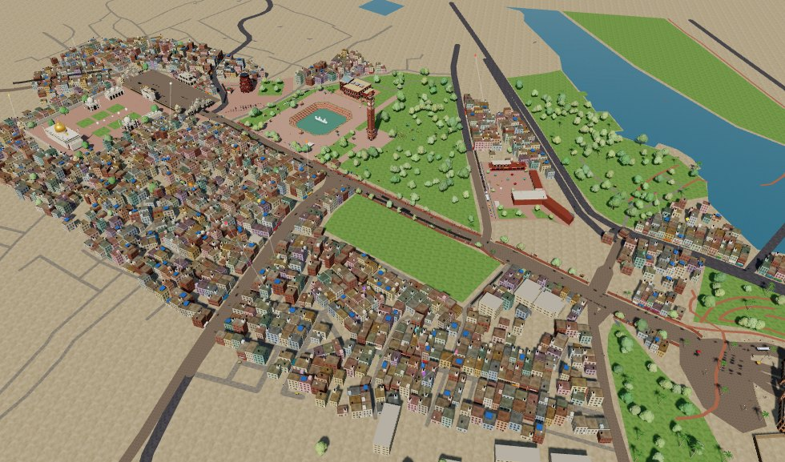
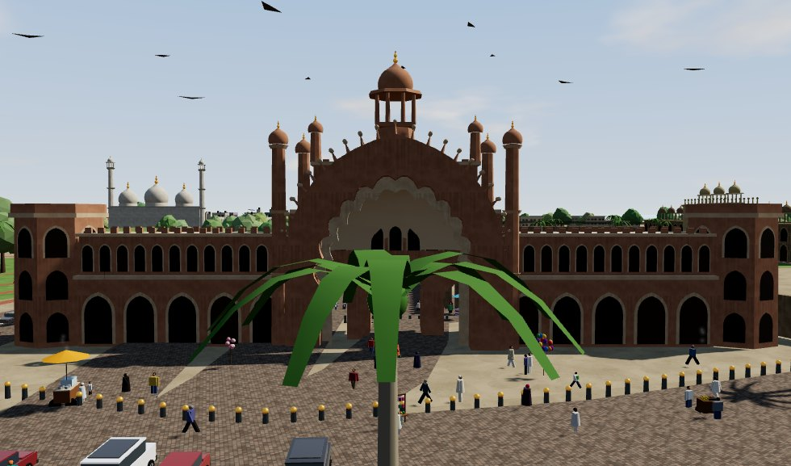
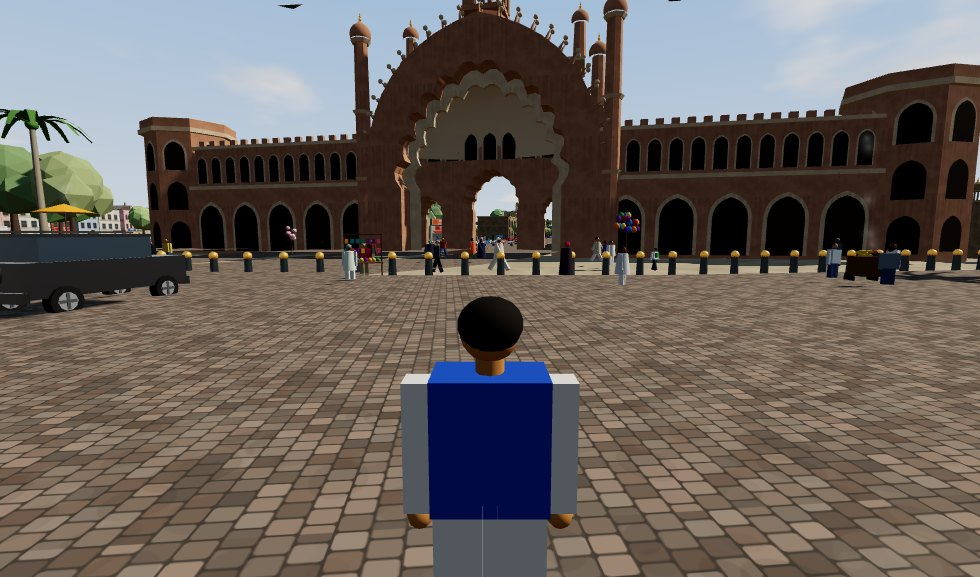

# Lucknow-3D enhancement plan · ASTRA 6.2

The **first release** should make the walk from the Clock Tower and Talab to Rumi Darwaza the best-documented, easiest-to-use part of the precinct. A visitor should be able to recognize a landmark from its approach, read why it matters, walk to a second stop, and return to the overview on a phone. This route exercises the project's strongest features together and gives the team a small enough area to check against references and real devices.

## What the current model shows

This review covers the checkout at `d0cb866`. I inspected the map converter, generated data, model builders, lighting, simulation, navigation and UI. I also ran the original scene in Chromium, using Three.js r160, software WebGL, Medium quality, the Midday preset, and a 980 × 577 render surface. The browser test fetched the pinned CDN modules through a TLS-verifying client in the cloud environment. Physical-device performance and architectural dimensions still need independent measurement.

The overview makes the shape of the heritage corridor legible. The roads, courtyards and dense rows of homes give the monuments a setting. Near the edges, the housing ends abruptly and featureless ground dominates the horizon. A clearly marked detailed area on the minimap and restrained distant scenery would help visitors understand where to explore. The map contains **477 road runs, 45 building footprints, 41 areas, 22 points of interest and four water polygons**. Most of the housing visible here is generated along streets. Its apparent detail exceeds the available building survey data. [Map data](../data/map.js) · [City generation](../src/city.js) · [Accuracy notes](../README.md#accuracy)

| Rumi Darwaza from its saved Explore view | The same gate from its Walk arrival |
| --- | --- |
|  |  |

The gate already has separately modeled faces, a readable scalloped arch and long flanking arcades. In Explore, a foreground palm covers the opening. In Walk, the opening reads clearly, but the top of the crown falls outside the arrival frame. **Changing the two camera anchors is a higher-value first edit than adding ornament.** The Clock Tower has a similarly strong silhouette. Its dial, masonry bands and plinth make better candidates for close-range work than increasing geometry across the precinct. [Landmark geometry and camera anchors](../src/monuments.js) · [Camera framing](../src/ui.js)

| Fixed view | Draw calls | Triangles submitted |
| --- | ---: | ---: |
| Whole precinct | 610 | 1,776,541 |
| Rumi Darwaza, Explore | 422 | 1,556,645 |
| Clock Tower, Explore | 450 | 1,430,224 |
| Rumi Darwaza, Walk arrival | 429 | 1,556,941 |

These single-frame readings come from `renderer.info.render`. The street-level gate view submits nearly as much geometry as the overview. In a same-camera experiment, I capped the tyre and spoke instance counts at the number of slots actually assigned to vehicles (590 and 135 in this run, out of capacities of 1,700 and 800). Submitted triangles fell from **1,556,645 to 1,255,865**, a **19.3% reduction**, with 422 draw calls in both frames. The experiment restored both counts immediately. Device frame time, thermal behavior and visual parity remain production acceptance checks. [Wheel allocation and animation](../src/life.js)

## Priority 1 · Make arrival, walking and recovery dependable

| Work item | Implementation | Release check |
| --- | --- | --- |
| Recover from a failed start | The module imports run before the page installs its error handler. Add an early bootstrap that reports module and renderer failures. Package the exact r160 core and matching addons with their license for static hosting. Offer Retry and a lightweight places list. Reuse the existing 2D map drawing if a fallback map is needed. | On a cold load with third-party requests blocked, the served scene opens. With WebGL disabled or a dependency deliberately missing, a visitor can read the place list. Check the documented direct-file entry separately because browser module rules differ. |
| Make water and boundaries agree with Walk | The running scene returned floor height 0 for world point `(230, −350)` inside a river polygon, away from the road. An out-of-bounds search at `(1100, −650)` returned that same location as a spawn. Rasterize water into the existing navigation grid, retain valid bridge decks, and have failed spawn searches keep the last valid position or use a verified arrival anchor. Preserve the special stepped floor at the Talab. | River interiors reject walking, a mapped bridge connects both banks, the ghat steps remain traversable, and an off-map double-click leaves the walker on valid ground. Check the gate, a railing, a narrow lane and every published arrival anchor. |
| Let visitors recover the interface | In a 390 × 844 emulated touch session, Places → Rumi Darwaza → Walk here → Exit returned to Explore. Activating Photo mode then left zero visible buttons and hid the exit hint. Add a focusable restore control outside the hidden overlay. Scope Walk shortcuts to the scene and associate settings labels with their inputs. | Without a keyboard, enter Photo from Options, rotate the phone and restore Explore. Using only a keyboard, operate settings, read a card, enter Walk and return focus to the initiating control. |
| Establish what is actually visitable | The README lists Jama Masjid. The data includes a named footprint and the code reserves its location, but generic extrusion skips it and the active outer-mosque builder constructs Teele Wali Masjid. Create a landmark inventory with coverage, source and available views. Mark Jama Masjid as map-only in the guide until a reviewed model is available. | Match each advertised modeled landmark to rendered geometry and a review image. Check the README, minimap, place cards and tour against the same inventory. |

Implementation entry points are the [HTML bootstrap](../index.html), [navigation and controls](../src/ui.js), [photo-mode CSS](../css/style.css), [2D map preview](../tools/map_preview.html), [mapped building exclusions](../src/city.js) and [outer-mosque builder](../src/monuments.js).

## Priority 2 · Spend the rendering budget where visitors can see it

1. **Benchmark the route on hardware.** Select one midrange Android phone and one integrated-GPU laptop, record their models, browsers, viewport and quality settings, and replay the same 60-second route three times after warm-up. Use clock time, weather, camera path and a test-only random seed to keep runs comparable. Test midday Explore, the gate walk, and an evening monsoon pass with traffic. Report cold time to first usable controls, median and 95th-percentile frame time, draw calls and triangles. Repeat the mobile route after ten minutes to reveal sustained slowdowns.
2. **Ship the wheel change first.** Finalize draw counts after all relevant actors have spawned, preserve stable slot indices and update counts if allocation grows. Check buses, rickshaws, parked traffic and night lighting at all three quality levels. Match the reduction above on the same view with complete vehicles. Use the measured frame-time change to decide how much additional detail the pilot can afford.
3. **Profile one bottleneck at a time.** Static geometry already merges by material, people and vegetation already use instancing, and distant pedestrians already update less often. For GPU-bound street views, partition one citywide tree or facade batch into bounded groups and compare the extra draw calls against saved geometry. For CPU or upload-bound views, test updating only changed crowd matrix ranges. For slow startup, time each of the six build phases and index nearby platforms if navigation dominates. Keep simulation positions continuous while actors are outside the view.
4. **Set a decision rule.** A proposed pilot target is p95 frame time at or below 33 ms on the selected phone's supported preset. Establish the first-device baseline before committing to that target. Accept each optimization only with matched crowd density, intact shadows and no visible pop along the route. If gains are small, stop there and spend the remaining effort on framing and navigation.

[Renderer and quality presets](../src/core.js) · [City batches](../src/city.js) · [Traffic and crowds](../src/life.js) · [Startup and frame loop](../src/ui.js)

## Priority 3 · Improve the architecture at two scales

| Subject | Modeling change | How to judge the result |
| --- | --- | --- |
| Rumi Darwaza | Reframe the saved approach around the central opening and add a reverse view to explain the two faces. Assemble dated, permission-cleared references for both elevations. Match opening proportions, crown profile and arcade rhythm first. Add shallow relief, recess depth and material variation only where the walking camera can resolve them. | Review paired renders from both approaches against the references. In landscape and portrait the curated views show the opening and crown. The public passage remains walkable and vehicle traffic still follows the modeled diversion. |
| Clock Tower and Talab | Use the tower, tank, gallery and connecting paths as one composition. Cross-check the mapped 67 m tower height and the base-to-dial and dial-to-crown proportions against an independent reference. Compare the tank's waterline, steps and landing edges at eye level. Feed visible steps and collision heights from the same dimensions. | Save one panorama, one dial close-up and a continuous descent to the water's edge. A reviewer can identify each changed feature and its reference. The walker can descend and return without clipping, floating or entering the water. |
| Public realm and skyline | Vary pacing along this route with a few sourced paving transitions, stall fronts, shaded waiting spots and locally appropriate trees. Give distant blocks simpler silhouettes and blend the detailed corridor into its surroundings. Start with one street segment. | Compare the same street before and after at noon and dusk. Signs are legible at walking distance, the route to the next stop is visible, and the segment meets the agreed phone budget. |
| Next landmark | Use the coverage inventory to choose Jama Masjid or another site with adequate references. For Jama Masjid, verify its footprint, orientation and facade before activating a builder. Start with a distant silhouette if the site will remain outside the walkable heritage route. | A dated reference sheet, a checked viewpoint, an accurate guide entry and performance results accompany the model. Offer a Walk arrival only when the surrounding approach is ready. |

For each pilot, record source, date, reuse rights, dimension or feature supported, and confidence. Separate mapped footprints, verified measurements and artist estimates in the guide. A locally knowledgeable reviewer should check the architectural terminology, inscriptions and historical claims. The existing metre-based landmark frames and shared Talab dimensions are good foundations for this work. [Coordinate frames and Talab](../src/core.js) · [Monument builders](../src/monuments.js)

## Priority 4 · Give the walk a guide that can grow with the map

**Places and language.** Move pilot place IDs, camera and walking anchors, source-backed claims, locale-specific names and descriptions into a small shared catalogue. Keep meshes in their existing builders. Cards, approach notices and tour stops should read the same record. Some shop entries currently copy Hindi into the Urdu field. Supply reviewed Hindi and Urdu where available, set the language and text direction per string, and use an explicit fallback for missing translations. Test the same place in its list entry, card and arrival announcement in all three languages. [Label creation](../src/monuments.js) · [Cards and language switching](../src/ui.js)

**Tour and discovery.** The current tour loops through eight destinations and an overview on a timer. Turn the pilot route into a visitor-controlled sequence with previous, next, pause, a stop count and a Walk-here action. Give the minimap a visible destination and a short, verified pedestrian route between the pilot stops. Let visitors read the same stops as a simple text itinerary. Under reduced-motion preferences, use an immediate viewpoint change and suppress automatic rotation and head bob. Permit page zoom on text panels while keeping scene gestures on the canvas. Verify the complete journey in portrait, landscape, keyboard-only and reduced-motion modes. [Tour and movement](../src/ui.js) · [Viewport and controls](../index.html)

**Map updates.** The Overpass query requests building and water relations, but the converter handles nodes and ways and skips relations. Generated features lack stable OSM element IDs, and parts of the city builder look up reserved sites by display name. Record the extract date, query hash and provenance. Carry typed OSM IDs through conversion, assemble multipolygon outer rings and holes, and maintain explicit overrides for hand-built sites. Update map rendering and navigation together so a courtyard remains open in both. Validate against small fixtures for a courtyard, a clipped river, a renamed landmark and a bridge. Regenerate twice from the same input, compare outputs, then review the change in the 2D preview and fixed 3D views before adopting a new extract. [Overpass query](../tools/overpass_query.txt) · [Converter](../tools/build_map.py) · [City builder](../src/city.js)

**Street life after the pilot.** Compare one quiet morning and one evening at the food court. The simulation already varies crowd and traffic counts by hour, animates vendors, and synthesizes street sound. Add a few place-specific behaviors first, such as customers approaching a stall and leaving a clear walking lane. Tie stall activity and localized sound to the same opening schedule, with sound opt-in. Inspect one fixed evening walk with weather set to clear and then monsoon. Check that arrivals and queues leave the gate passable, voices or sound cues fade with distance, and the wet paving still shows the route on Low quality. Expand to another street only if the difference is recognizable and the device budget holds. [Actor updates](../src/life.js) · [Weather and time](../src/sky.js) · [Street sound](../src/ui.js)

## Delivery sequence

Estimates are planning ranges in person-days for a small team familiar with Three.js. Access to physical devices, licensed imagery and local reviewers determines the calendar. The route can ship before the next map refresh.

| Milestone | Work and owner | Depends on | Exit decision |
| --- | --- | --- | --- |
| 1 · Establish the baseline · 2–4 days | Frontend engineer records device runs and route checks. Modeler inventories advertised places and prepares both gate views. | Existing checkout and reference devices | Agree on the mobile preset, pilot route, camera views and coverage wording. |
| 2 · Repair the journey · 5–9 days | Frontend engineer delivers boot recovery, touch exit and safe spawn/water handling. Rendering engineer validates the wheel-count change. | Baseline and stored views | A first-time visitor can open, walk, recover and leave on both target devices. Re-run bridge, ghat and gate checks. |
| 3 · Release the heritage pilot · 8–15 days | Modeler and heritage reviewer refine the gate and tower. Frontend and language reviewers deliver sourced cards, manual tour controls and accessible arrival views. | Licensed references, stable anchors and measured rendering headroom | A visitor can identify the two landmarks, explain one sourced distinction between the gate faces and complete the route in their chosen supported language. |
| 4 · Expand coverage · 5–12 days for the data foundation | GIS and rendering contributors add stable IDs, multipolygon fixtures and visual diffs. Select the next site using the inventory. Estimate that site's model after its reference review. | Pilot and a dated OSM extract | An updated map preserves the pilot's landmark placements, open courtyards and walkable crossings. |

Start with the existing Rumi camera. Move it until the crown and opening clear the palm in landscape and portrait, and save those views. Pair this with the wheel-count experiment as a separate, measurable change. Together they give the next reviewer a visible improvement and evidence about the cost of representing it.
