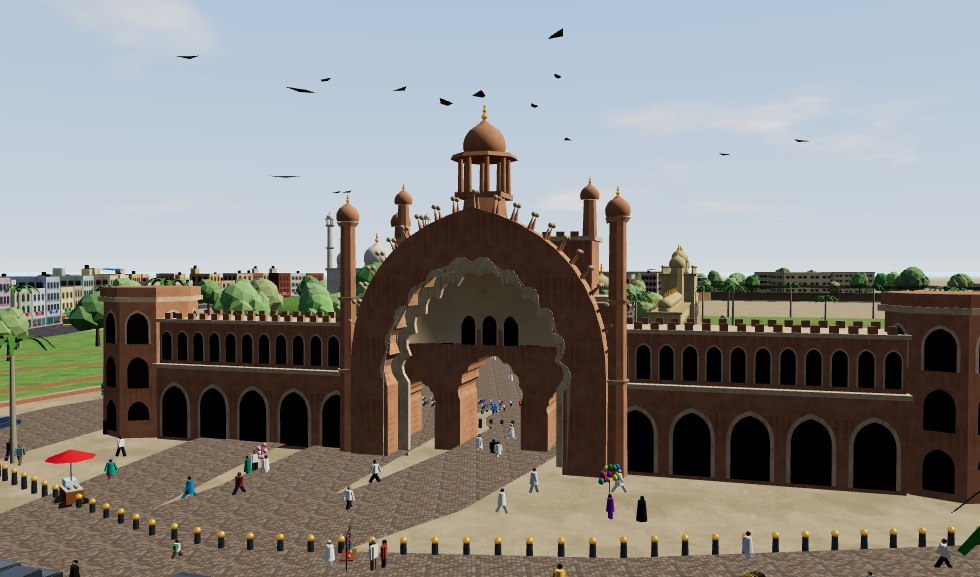
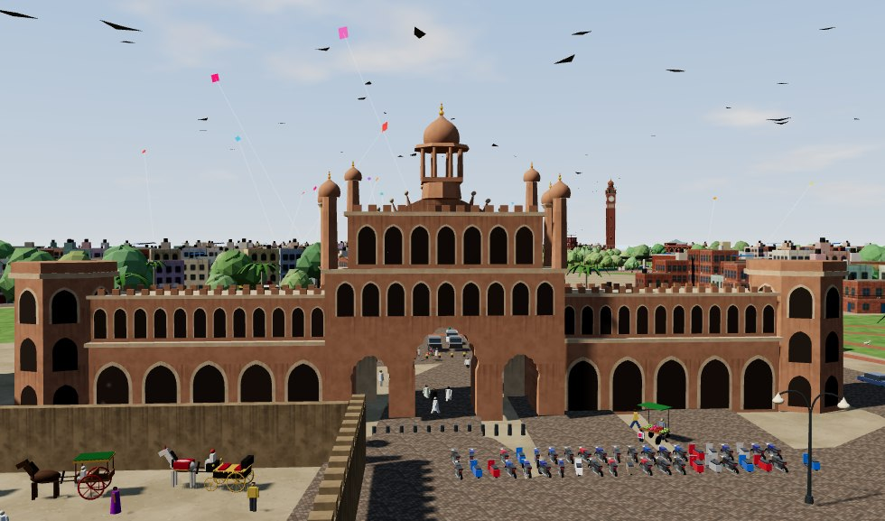
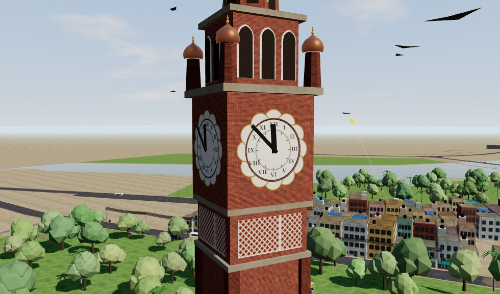
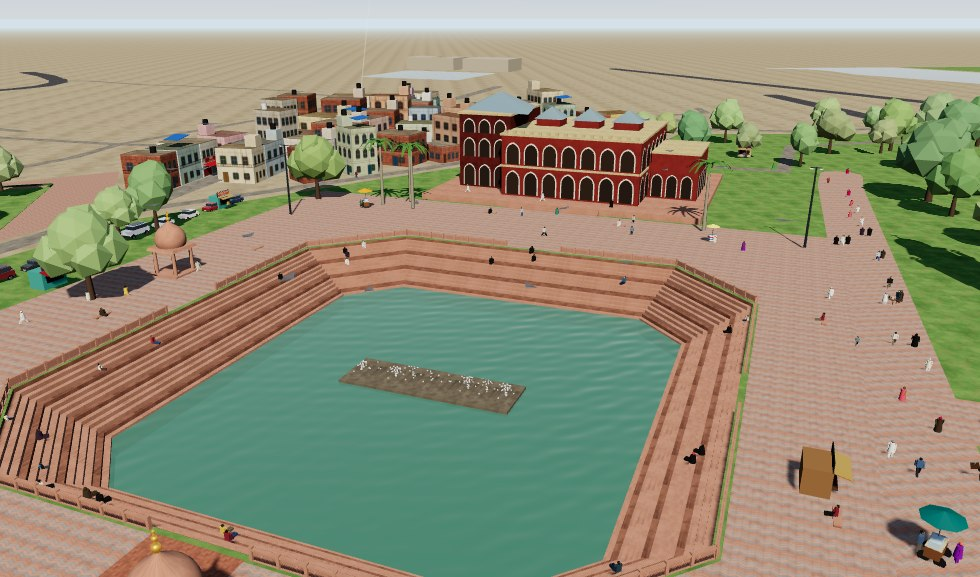

# ASTRA 6.2 heritage walk

The pilot goes from the Clock Tower to Husainabad Talab and Rumi Darwaza. Each stop has a saved view, a walking arrival and an account of what to look for in English, Hindi and Urdu. The two walking legs are about 91 m and 609 m in the scene. The minimap draws the next leg after checking it against the walking surfaces in the active graphics preset.

| Rumi Darwaza, west | Rumi Darwaza, east |
| --- | --- |
|  |  |

The west view moves off the palm's axis. The reverse view lets visitors compare the two faces from the similar heights and distances. A shallow trim follows the west opening. The over-the-shoulder arrival shows the crown and passage in a portrait frame. [Portrait walk view](implemented/rumi-walk-portrait.jpg)

| Clock Tower dial | Talab and Picture Gallery |
| --- | --- |
|  |  |

## Landmark inventory and sources

| Coverage | Guide and model evidence | Source and confidence |
| --- | --- | --- |
| Clock Tower | Tour stop with forecourt and dial views. The dial hands still follow the selected Lucknow time. | The checked-in OpenStreetMap footprint has a 67 m height tag. The model's dial and bands follow the existing procedural reconstruction. Independent measurements are pending. [Map data](../../data/map.js) · [Builder](../../src/monuments.js) |
| Talab and Picture Gallery | The tank has an Explore panorama, a south-rail arrival and 13 traversable modeled steps. The gallery also has a separate Places card. | The model shares its tread, rise and water boundary with walking navigation. The checked-in map locates both features. The measurements are scene dimensions. [Dimensions](../../src/core.js) · [Builder](../../src/monuments.js) |
| Rumi Darwaza | Tour stop with west and east views and an arrival facing the public passage. The vehicle simulation uses the bypass. | The OpenStreetMap footprint locates the gate. Its two silhouettes and details are based on the previous procedural model. Dated elevation and conservation references remain to be reviewed before an architectural accuracy claim. [Model](../../src/monuments.js) · [Traffic](../../src/city.js) |
| Satkhanda, Chota Imambara, Bara Imambara and the food court | Modeled destinations with individual Places entries. The Husainabad gateways, Asfi Mosque and Teele Wali Masjid appear in the scene with map labels. | Existing modeled sites and guide text. The geographic data is from OpenStreetMap. [Builder](../../src/monuments.js) |
| Jama Masjid | Listed in Places as a map location, with an OpenStreetMap link. | The map contains the footprint. This site remains outside the detailed pilot while elevation and approach references are gathered. [Map data](../../data/map.js) · [Place catalogue](../../data/places.js) |

The bundled extract predates snapshot metadata. OpenStreetMap data uses ODbL 1.0. The images here are renders of the project. The new guide copy describes the model and identifies the mapped height separately from interpretation. The Hindi and Urdu copy still needs review by local readers. Shops that lack Urdu names show their English names in Urdu mode. [Map license](https://www.openstreetmap.org/copyright) · [Guide copy](../../data/places.js)

## Verification

- The scene starts over HTTP with third-party requests blocked. The fallback displayed the itinerary with WebGL disabled and recovered from a missing bundle after Retry. Pinned Three.js and the addons build byte-for-byte from the npm lockfile. Managed Chromium blocks top-level `file:` navigation by policy, so the direct-file entry requires a check in a browser that permits it.
- Browser checks covered both walking legs on Low, Medium and High, a full Talab descent and ascent, a Rumi passage, a bridge deck, an open-water point and an out-of-bounds spawn. The keyboard check reached the settings and returned focus to Walk. The touch check restored the interface after rotating in Photo mode.
- At the same Medium Rumi view, drawing the assigned wheel instances reduced the sample from 1,559,430 to 1,263,378 submitted triangles, about 19%. This was measured with software WebGL. [Wheel allocation](../../src/life.js)
- The map import fixtures cover a split courtyard boundary, clipping a river with an island, bridge tags, stable IDs after renaming and repeatable output. The generated fixture loaded beside the original extract in the 2D preview. The active map still uses the checked-in extract. [Import tests](../../tools/test_build_map.py) · [2D comparison](../../tools/map_preview.html)
- The 60-second Low run completed all three passes in software WebGL. The evening pass exercised rain, wet paving and the modeled food-court schedule. Two customers appeared in the evening check and the same stalls were quiet at dawn.

For the hardware baseline, run the benchmark at the same viewport and preset on the target phone and laptop. Save each JSON report with the device model and browser. Use the 95th-percentile frame interval for the proposed 33 ms phone target and compare the optional post-soak run. The project has a working benchmark and software WebGL measurements. Hardware frame time and thermal results still need recording. [Benchmark](../../tools/benchmark.html)
