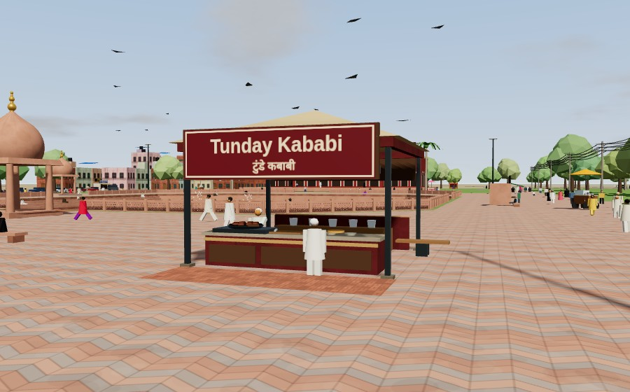
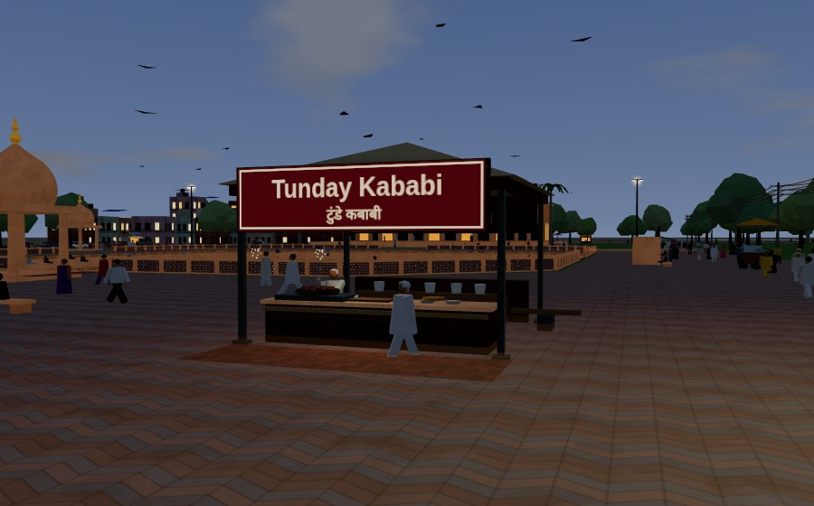
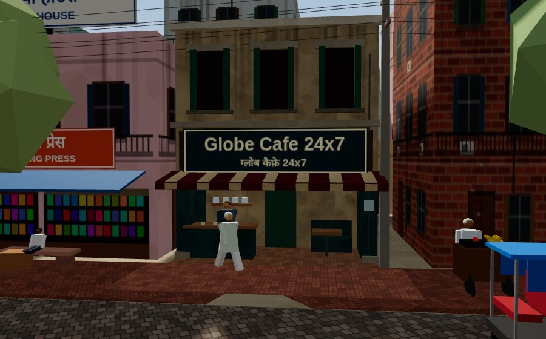
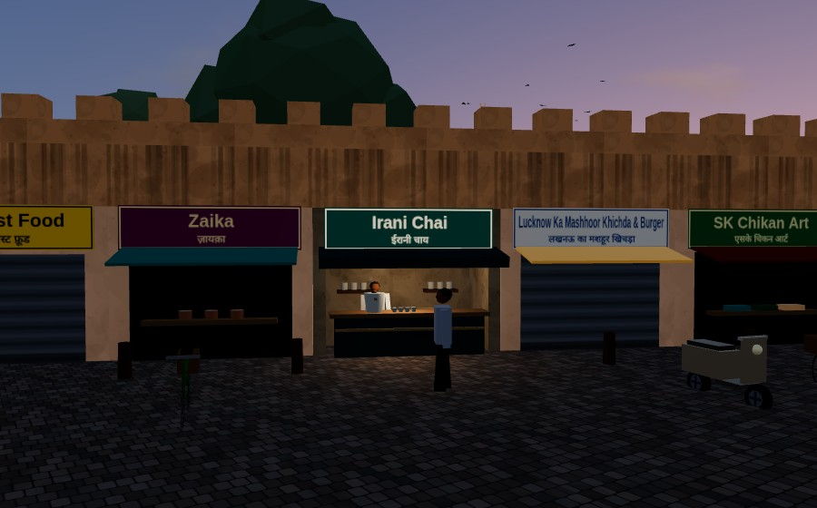

# Street shops and lighting in ASTRA 6.2

Open **Places → Street shops** to visit Tunday Kababi, Globe Cafe 24x7, Irani Chai, Irani Dum Tea, Chai Mahal and Kamar Sheermal Shop. Each has a street view, a counter view and a walking arrival. Tunday also has a view from the square. The three-language place guide and the text fallback carry the same storefront descriptions.

| Updated Tunday at midday | Updated Tunday at civil dusk |
| --- | --- |
|  |  |

| Updated Globe | Updated Irani Chai at dusk |
| --- | --- |
|  |  |

The storefronts share metre-based anchors for geometry, nameboards and public arrivals. The Tunday fascia sits forward of the canopy. Globe’s dedicated plot keeps its façade in the same place at every graphics setting. Irani Chai and Irani Dum Tea retain separate names and bays, with different signs and vessels. The surrounding model gains recessed display space, paving strips, a kerb cut, a drain and shop-side fittings. Reserved entrances keep procedural trees, parked vehicles and carts clear of the approaches. [Baseline and camera positions](shops-and-lighting-roadmap.md) · [Irani Chai at midday](shop-implementation/irani-midday.jpg) · [Shop models](../../src/shops.js)

## Map evidence and scene schedules

Chai Mahal uses the tea-shop point in the bundled OpenStreetMap extract, at approximately `26.87453°, 80.90671°`. The other five modeled placements come from the preceding scene and its shop audit. In the app this coverage appears as **Illustrated storefront**. Contemporaneous street photographs, branch confirmations and opening hours could not be accessed from the cloud workspace. The models use authored geometry and original sign artwork. The clock drives illustrated hours, including the earlier tea service and later kebab counter. [Catalogue](../../data/places.js) · [Bundled map](../../data/map.js)

## Lucknow time and weather

Live time uses IST, including the solar date after local midnight. The presets use apparent sunrise, solar transit, a descending solar elevation of 6° for golden hour, civil dusk at −6°, and 22:00 IST for Night. The slider selects any minute. The directional light and sun disk share a direction while the sun casts shadows. Dusk has a cooler ambient gradient, with warmth concentrated toward the setting sun and the active counters. Clouds dim stars and direct sunlight. Monsoon rain roughens the water surface and changes the reflection from exposed paving. Individual counters ease between shutter, staff, customer, steam and optional sound states. [Solar calculation](../../src/solar.js) · [Weather and light](../../src/sky.js) · [Rainy dusk render](shop-implementation/tunday-rain.jpg)

## Verification

- All six frontages retained their anchors across Low, Medium and High in Chromium. Their exact arrivals, pedestrian bypasses and customer loops cleared the collision grid. Both heritage legs measured 91.3 m and 609.1 m.
- Browser checks used keyboard selection from Places, a mouse click on the Tunday label and touch interaction in a 360 × 640 viewport. The shop cards showed Hindi and Urdu with right-to-left text where appropriate. With WebGL disabled, the localized text guide appeared. Retry recovered the scene after WebGL was restored.
- The solar test compared an equinox and both solstices with Astral 3.2 at the map origin. Apparent sunrise, solar transit, sunset and civil dusk agreed within a minute. Live mode advanced from 23:59 to 00:01 IST in two browser time zones. A resumed preset followed the updated date while a manually selected minute stayed fixed.
- The Tunday counter moved through evening rain, midnight and sunrise twice without retaining idle customers or steam. A separate browser test enabled street ambience, measured audible-range counter gain while it was serving and verified that it faded on closing and suspended when switched off.

## Rendering measurements

The comparison used Low, a 900 × 560 viewport, software WebGL and one ten-second sample per pass. The baseline was `14ab9e4`. The three heritage passes submitted fewer triangles in the updated scene. The evening tour drew more batches. The 13–29 frames per pass provide only a coarse frame-time comparison.

| Pass | Median frame interval, baseline → updated | Median draw calls, baseline → updated | Median triangles, baseline → updated |
| --- | --- | --- | --- |
| Midday Explore | 350 → 367 ms | 354 → 372 | 957,009 → 934,550 |
| Rumi Darwaza Walk | 483 → 467 ms | 369 → 371 | 1,096,076 → 1,071,457 |
| Evening monsoon Tour | 767 → 783 ms | 674 → 722 | 1,285,881 → 1,266,391 |
| Tunday counter at midday | 433 ms | 362 | 931,526 |
| Tunday counter at rainy dusk | 417 ms | 500 | 935,946 |

Use **Include shop passes** to repeat the fixed Tunday counter view at midday and in rain at civil dusk. Real phone and laptop frame-time and thermal checks still require those devices. [Benchmark page](../../tools/benchmark.html)
