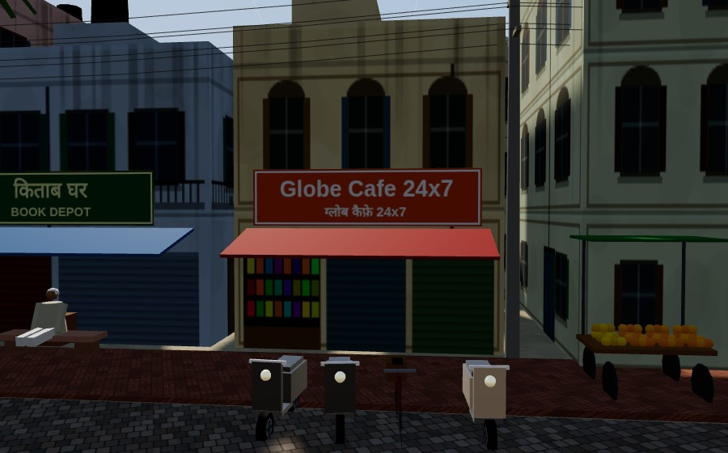
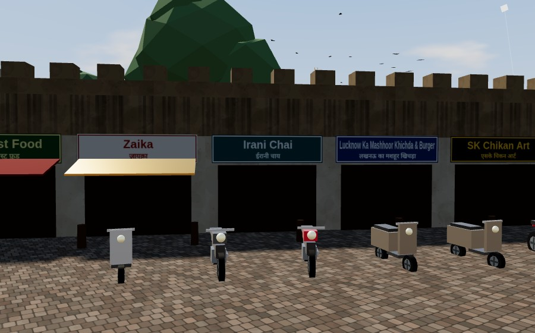
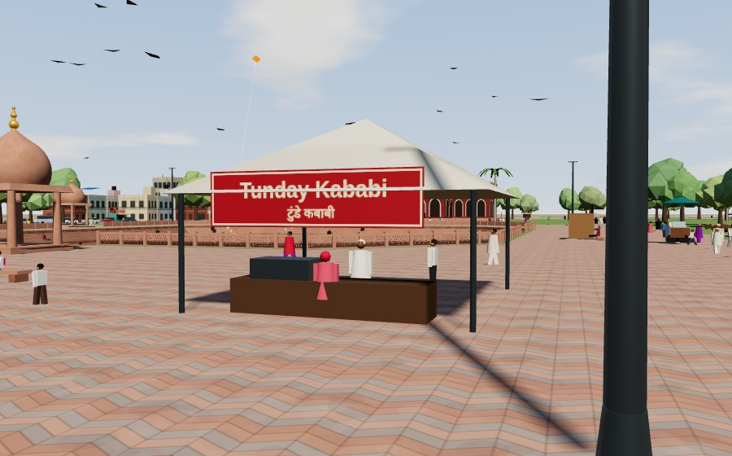
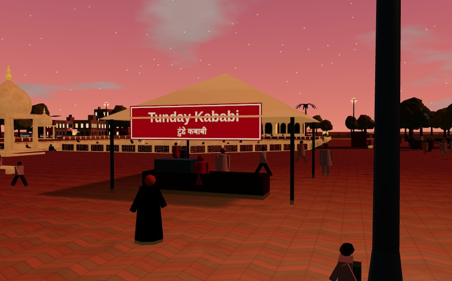

# Lucknow street shops, Tunday Kababi and the city through the day

**Proposed next release on `ASTRA-6.2`, based on `14ab9e4`.** Start with three places a visitor can recognize on foot. At Globe, the entrance should read as a café. At Irani Chai, the visitor should see where tea is poured and collected. At Tunday, the visitor should be able to read the sign, watch the cook at the tawa and walk past the counter. Return to that same counter at dusk to judge whether the lighting works. These views give the shop, street and lighting work a common test.

## Street-level review

| Globe Cafe 24x7 at midday | Irani Chai at midday |
| --- | --- |
|  |  |

| Tunday Kababi at midday | The same counter at dusk |
| --- | --- |
|  |  |

These are renders of the existing project in Chromium with software WebGL, Medium quality, a 900 × 560 viewport, clear weather and the benchmark date of 18 November 2026. The camera captured the 3D canvas with floating labels excluded. The city catalogue has 54 business entries and four public signs. All three requested names already appear on physical boards. Their addresses, operating hours and present façades still need independent confirmation. [Shop catalogue and signs](../../src/city.js) · [Park and Chota models](../../src/monuments.js) · [Checked-in map](../../data/map.js)

| Site | What the implementation does today | First edit |
| --- | --- | --- |
| **Globe Cafe 24x7** | The catalogue suggests world `(−96, 58)`. `nameShops()` searches nearby generated houses and can fall back to a kiosk. In the captured run the frontage resolved to approximately `(−98.0, 64.0)`. | Verify which “Globe” and which entrance the name refers to. Give that frontage an explicit facing and pedestrian arrival. Mount the board clear of the awning and open one service or seating bay so the café is recognizable from the pavement. Treat “24x7” as part of the existing name pending hours verification. |
| **Irani Chai** | Occupies the seventh bay on the positive-local-x side of the Chota Imambara street wall. Its tuple has placeholder coordinates. The builder positions its board correctly but creates floating labels only for alternate named bays, skipping this one. Irani Dum Tea and Irani Fast Food have their own entries. | Bind the board, label and arrival to this bay using its local transform. Add a recessed serving ledge, metal tea vessel, cup stack and a visible handover point. Check the neighboring boards from both directions and the gate approach. |
| **Tunday Kababi** | The park builder places a four-post canopy, two boards, a cook and a simple counter at park-local `(−52, 60)`. The label uses a second copy of that position. The checked-in extract does not identify a Tunday branch there. | Fix the canopy/sign overlap first. Build the counter as a working kebab stall, then use dated evidence to settle its branch identity, location and façade before presenting it as a real outlet. |

## 1. Verify the shops and add names visitors can actually find

1. **Work street by street.** Survey the Clock Tower park edge and the commercial frontage around Globe, then the Chota wall row. For each candidate, record the exact trading name visible from the street, aliases, street-facing side, two adjacent features and the date. Pair a storefront reference with an address, public map pin or an owner's confirmation. Record what each source establishes and the reuse terms for any image or artwork. A nearby listing can identify a business while leaving its precise entrance unresolved.
2. **Build a shortlist for expansion.** Chai Mahal is an immediate cross-check because it has both a tea-shop point in the bundled map and a separate hard-coded model. Kamar Sheermal Shop, Kebabchi Lucknow and Chaurasiya Bakery are existing names worth making discoverable after review. For genuinely new names, survey one additional tea, bread or food business on each street, compare spelling and aliases against the 54 entries, and add the confirmed names to the catalogue. Rahim’s and Prakash Ki Mashhoor Kulfi are candidates to research if the guide expands across Lucknow. A confirmed address beyond this precinct belongs in a city guide or future map expansion.
3. **Give each featured business a stable ID.** Extend the plain visitor data in `data/places.js` with names by language, aliases, placement type, a frame or frontage anchor, facing, a street-side arrival, source/date and the status of the placement and appearance. Distinguish field-verified, mapped and interpreted details. For Tunday, keep an explicitly interpreted park stall while evidence is pending. If the identified branch is elsewhere, place the named entry at its supported location and use a generic name for the park stall.
4. **Connect the record to the scene.** In `src/city.js`, reserve the featured frontage before generic shops are assigned. In `src/monuments.js`, resolve each wall bay or bespoke stall from the same record. Keep atlas cells as rendering indices and use the stable IDs for selection. In `src/ui.js`, let visitors open the featured shops from Places and select their visible labels. Reuse the existing cards, Walk action, focus return, language fallback and phone label limits. The heritage itinerary continues to use its three curated stops. [Visitor data](../../data/places.js) · [Shop placement](../../src/city.js) · [Labels and Places](../../src/ui.js)

**Acceptance.** Each featured shop resolves to one location on Low, Medium and High. Selecting it from Places lands outside the correct entrance, facing the actual board. With labels off, a visitor can still identify it from its sign. Check English, Hindi and Urdu, including right-to-left layout and the existing English fallback for missing copy. Test alias collisions, particularly “Irani Chai” and “Irani Dum Tea”.

## 2. Rebuild Tunday and dress the surrounding streets

| Area | Instructions for the modeler | Street-level check |
| --- | --- | --- |
| Tunday silhouette and sign | Extract the dedicated stall from `buildPark()`. Use one transform for its canopy, fascia, counter, cook and label. Give the sign a physical mounting face outside the roof edge. Match the roof profile, lettering and colors to dated frontage references where available. | Read the full name from both public approaches at roughly 12–15 m in landscape and portrait. The canopy edge clears both scripts. |
| Tunday counter and service | Put a broad, dark iron tawa with a few kebabs at the cook's station, a preparation board and small utensil shelf behind it, and plates or wrapped bread at the collection end. Separate the cook’s reach from the customer’s waiting position. Use one warm task light over the counter at dusk. | From 3–5 m, identify the cook, cooking surface and pickup point. Watch one approach, order and departure. People stay on their own side of the counter and the route past the stall stays open. |
| Globe frontage and neighbors | Give the café a recessed entrance, identifiable counter or tables, and shade appropriate to its verified frontage. Along the same section, study the neighboring shutter widths, upper-floor windows, overhead wires and kerb. Retain a few recognizable differences between adjoining premises. | The café reads from across the street and at the door. Awnings, parked scooters, branches and overhead wires leave the sign and arrival visible. |
| Irani Chai and the Chota wall | Use the existing bay width and wall rhythm. Give the serving ledge depth, vary the adjacent open and shuttered bays using references, and reserve a pickup recess. Place parked cycles or scooters at observed pull-offs. | The tea bay is identifiable beside Zaika. The covered service area faces the public side. Visitors can pass between waiting people, kerb posts and the gate. |
| Park edge and pavement | Survey one continuous approach to each featured shop. Add paving transitions, kerb cuts, covered drains, bench wear, bins, cable runs and planting gaps where the reference shows them. Preserve the view to the Talab and the Clock Tower. Use repeated low-cost meshes for distant fittings. | Walk both directions at eye height, repeat after rain, and check that the surface, kerb and shop threshold remain distinguishable on a phone. |

Use `bake()` for static geometry and shared atlas materials for signs. Assign collision to posts, counters and other solid fixtures before `buildNav()`. Keep cups, lettering and trim out of the collision grid. In `planStreetFurniture()` and `buildStreetDetail()`, reserve the entrance, service queue and pedestrian passage before scattering vehicles, carts and trees. Put any moving shutters and actors in small separate groups so the static mesh can stay merged. Give Low the same sign, counter silhouette and clear path as High. Spend the extra detail on near-view utensils, contact shadows or a little steam. [Geometry batching](../../src/core.js) · [Street furniture](../../src/city.js) · [Vendor behavior](../../src/life.js) · [Walking surfaces](../../src/navigation.js)

## 3. Make each time of day look like Lucknow

Use Lucknow local time, **Asia/Kolkata, UTC+05:30**. The current scene already computes the sun from latitude, longitude and date. Live advances the hour, while the solar date and named events are initialized at startup. Sunrise currently selects 15 minutes after the model’s geometric sunrise. The same elevation palette serves morning and evening, and a shared emissive material brightens many shopfronts together. These are separate issues with different tests. [Solar model and weather](../../src/sky.js) · [Clock and controls](../../src/ui.js)

| Moment | Light, materials and atmosphere | Activity around the shops |
| --- | --- | --- |
| Sunrise and early morning | Place the disk near the eastern horizon, retain cool light in shaded façades, and let east-facing signs catch the first direct light. Under winter fog, soften distant silhouettes while keeping the nearby kerb legible. | Show preparation where the scene schedule calls for it. A tea counter can be lit before neighboring shutters rise. |
| Midday | Use the date-specific solar altitude for shadow length. Keep shadow detail under the Globe awning, control glare on metal and preserve the color of pale plaster. Under overcast skies, soften contrast and shadows. | Show normal service and a few people resting in shade. Keep the adjacent footpath clear. |
| Golden hour | Warm the west-facing surfaces, preserve cooler sky fill on the opposite wall and lengthen shadows away from the disk. Check the metal tawa and Talab water for the same light direction. | Bring customers into waiting positions gradually and illuminate individual work areas as daylight falls. |
| Dusk | Let the bright horizon fade into cooler ambient light. Light Tunday’s work surface and Irani’s serving bay before the pavement disappears into shade. Fade visible stars with twilight and cloud cover. | Increase modeled evening activity where appropriate. Start a quiet local serving sound only while a stall is active and the visitor has enabled sound. |
| Night | Separate light from a counter, a streetlamp and the Clock Tower. Let quiet stretches stay dark while preserving kerb edges and faces at the point of service. Reserve decorative color for the existing festive option. | Give each featured shop a distinct closing or late-service state. A closed counter has a shutter or cover, with its customer loop, steam and serving audio faded out. |

**Implementation order**

1. In `src/sky.js`, separate Lucknow civil date and hour from the solar calculation. Refresh the cached events on local date rollover and when a suspended tab resumes. Define Sunrise at apparent sunrise (solar centre around −0.833°), Midday at solar transit, Golden hour at a documented descending elevation, and Dusk at a documented twilight event such as civil dusk (−6°). Preserve the time scrubber, Live, fixed Night and the benchmark’s frozen date.
2. Align the sun disk and the directional light while the sun casts discernible shadows. Fade solar shadows near the horizon, and use a separate ambient contribution for night. Derive sky, direct light and reflected light from the same solar sample. Adjust dawn and dusk gradients using dated local photographs taken facing known directions. Start with shaded signs, neutral plaster and the Talab reflection as color references.
3. Keep clear, haze, overcast, winter fog and monsoon independently selectable at every hour. Under rain, reduce direct light and concentrate the strongest reflections on wet paved surfaces. Check that rough plaster, dry areas under awnings and the water surface respond differently. Reuse cached reflection settings and emissive masks to avoid rebuilding sky probes per frame or adding shadow-casting lights at every shop.
4. Extend the existing food-court pattern in `src/life.js` and `src/ui.js`. A shop’s modeled service state should drive its shutter, task light, staff, short queue, steam and opt-in sound together. Apply gradual transitions when the visitor scrubs the clock. Publish real opening hours only with a dated source. [Weather and activity curves](../../src/sky.js) · [Customers and effects](../../src/life.js) · [Street sound](../../src/ui.js)

## Delivery roadmap

Estimates are **person-days** for these three sites and their immediate approaches. Reference collection and access to test devices determine calendar time.

| Sequence | Owner and effort | Deliverable and exit check |
| --- | --- | --- |
| 1 · Survey and baseline | Local researcher + modeler, 2–3 days | Mark the three approaches, inventory visible neighbors, record evidence and unknowns, select new-name candidates, and save a phone and laptop performance baseline. Choose the supported treatment for Tunday. |
| 2 · Names, placement and discovery | Frontend + scene engineer, 2–3 days | Implement stable shop records, explicit anchors, localized cards and safe arrivals. Verify signs and labels resolve to the same frontage across presets. Add surveyed businesses as evidence arrives. |
| 3 · Tunday and two street sections | Modeler + scene engineer, 4–6 days | Deliver the Tunday counter first, then Globe’s frontage and Irani’s wall row. Repeat the four baseline views and walk every approach with labels disabled. |
| 4 · Sky, weather and service states | Rendering + simulation engineer, 3–5 days | Solar/date work can start alongside the shop models. Integrate local lighting and activity after the models expose their counter and queue positions. Review all five moments from the same camera. |
| 5 · Field review and tuning | Local reader/reviewer + QA, 2–3 days | Resolve location and spelling issues, verify collision and legibility, and record repeatable device results. Expand to the next pair of businesses only after these three pass. |

## Reproduce the review and decide when to ship

- **Repeat the views.** Open the served scene at `/?benchmark=1&quality=medium`, use 900 × 560 and Clear. For Tunday, in the park frame, use camera `(−46.5, 2.2, 76)` looking at `(−52, 2.1, 60)` at Midday and Dusk. For Irani, use Chota-local camera `(37.44, 1.9, −18)` looking at `(35.44, 2.3, −3.65)`. For Globe, start at its resolved sign, move 13 m outward and 1.4 m along the façade, set eye height to 2 m and aim at the sign at 2.95 m. Repeat from the public Walk arrivals in 360 × 640 portrait. If a verified location changes, keep both the original comparison and a new correctly oriented frontage view.
- **Check time independently.** Compare sunrise, transit and sunset at the map origin with a dated almanac for both solstices and an equinox. Use ±5 minutes as an initial tolerance, with the same horizon convention. Test 18:29 to 18:31 UTC across Indian midnight, resume the tab the next day, and repeat in two browser time zones. The time bar and tower hands should agree. With shadows enabled, compare a vertical post’s shadow direction with the visible sun and its length with post height divided by the tangent of solar elevation.
- **Check street use.** Walk past each counter while it is busy, enter and leave via Places using touch and keyboard, and confirm that both existing Clock Tower–Talab–Rumi walking legs still pass `walkableLeg()`. Repeat with reduced motion, labels off and WebGL fallback. Scrub evening → night → sunrise twice and check for duplicate customers, lingering steam or audio at a closed stall.
- **Measure the cost.** Keep the existing three benchmark passes for comparison. Add a separate fixed-camera busy shop test at clear midday and rainy dusk. Run three warmed trials at the same size on a midrange Android phone (Low) and integrated-GPU laptop (Medium). Save startup time, draw calls, triangles and median/p95 frame interval. Use the prior roadmap’s phone target of 33 ms p95. If the baseline already exceeds it, record the gap and require the shop changes to match or improve the baseline before adding optional effects. Software WebGL screenshots establish appearance. Hardware runs establish the performance result. [Benchmark](../../tools/benchmark.html) · [Benchmark passes](../../src/benchmark.js) · [Previous verification](implementation.md)
